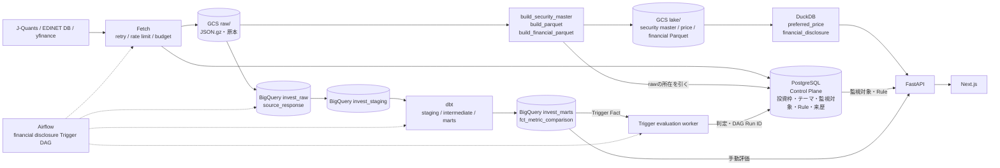
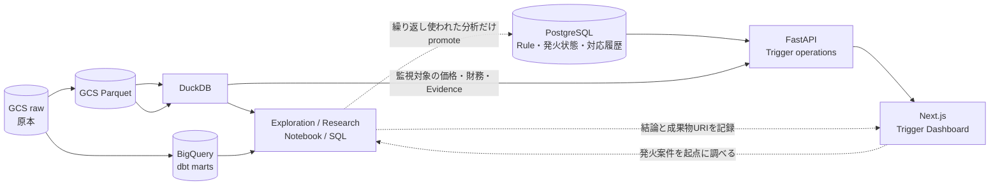
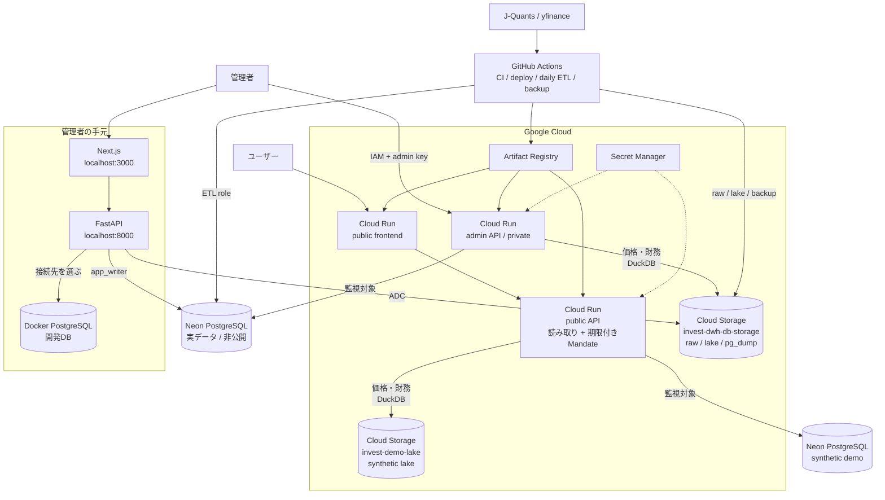

# アーキテクチャ

この文書は、データフロー、実行環境、権限境界、FastAPI内部の責務をまとめたシステム構成の正本です。
列定義や取得元の選択は扱いません。

## 全体データフロー

外部APIから取得したデータは**まずrawとして保存**し、そこからParquetを組み立てます。
rawが原本で、ParquetもPostgreSQLも派生です。

**PostgreSQLとParquetは役割が違います。** PostgreSQLは「何を監視しているか」を持ち
（Control Plane）、Parquetは「その値がいくらだったか」を持ちます（Data Plane）。
価格と財務はParquetからしか読みません。

全銘柄マスタもParquetに置き、APIの検索を経て選んだ銘柄だけをPostgreSQLの`investment_target`へ登録します。
`watchlist_entry`は検討・監視状態、`mandate_target_assignment`は投資枠で採用した目標配分です。
両者は独立し、Mandateへの採用だけではWatchlistへ追加しません。また、いずれも実保有を意味しません。
実保有は将来の証券会社データ取り込みによるPositionから判定します。

**rawからの経路は2本あり、互いを参照しません。** BigQueryはParquetを読まず、DuckDBは
BigQueryを読みません。Parquet / DuckDBは日次運用とAPIの読み出し、BigQuery / dbtは
複数年度・複数銘柄を横断する分析履歴です。どちらもGCS rawを原本とし、削除して作り直せます。

公開デモには外部取得データを流しません。同じコードを通し、別バケットのsynthetic
Parquetと別PostgreSQLだけを参照します。分離はコードの分岐ではなくバケットの権限で
担保します。

| 層 | 責務 | 主な実装 |
|---|---|---|
| 外部データ | 原データの提供 | J-Quants、yfinance |
| 取得・ETL | 取得、raw保存、来歴記録 | Python、GitHub Actions、Airflow |
| 分析層 | 正規化、Parquet構築、Derivedの計算 | pyarrow、DuckDB |
| Control Plane | 監視対象・テーマ・構成・Trigger Rule / scope・取込メタデータ | PostgreSQL |
| アプリケーション | データアクセス、HTTP提供、画面表示 | FastAPI、Next.js |

## Exploration PlaneとOperational Plane

Operational Planeの入力は、dbtが計算した`invest_marts.fct_metric_comparison`です。
DuckDB版の同一計算はローカル開発・fixture・結果照合のために残し、本番判定の正本にはしません。
Rule・判定・対応履歴はPostgreSQLが持ちます。判定契約と実装範囲は
[Trigger Operations Pilot](trigger-operations-pilot.md)が正本です。

### 2つのPlane

| Plane | 目的 | 実装 | 保存するもの |
|---|---|---|---|
| Exploration / Research | 横断・時系列分析、原因分析、仮説の検証 | BigQuery、dbt、DuckDB、Notebook、SQL | 分析コード、パラメータ、結果要約。中間結果は原則一時的 |
| Operational Decision System | Rule、発火状態、人間の対応履歴の継続運用 | PostgreSQL、FastAPI、Next.js | バージョン付き定義、実行結果、Evidence参照、確認・判断履歴 |

FastAPIは任意の探索クエリをHTTP機能として固定する場所ではありません。一度限りのスクリーニングや検証は
Research側で行います。継続監視する利用者、更新頻度、判断への接続、欠損時の扱いが決まったものだけを、
Assessment Definition、Trigger、Dashboardへ昇格させます。Derivedが存在することや、分析が興味深いこと
だけを理由にAPI endpoint、Web画面、定期martを追加しません。

## 分析基盤の使い分け

**DuckDBとBigQuery/dbtは置き換えではなく併存します。** 同じ問いに2つの答えを持たせないため、
役割を分けます。

| | DuckDB + Parquet | BigQuery + dbt |
|---|---|---|
| 探索・試行錯誤 | **採用**。無料・即座・外部依存なし | スキャン課金が試行回数に比例する |
| 合成データでのテスト | **採用**。`tmp_path`にParquetを書いて実行 | 認証とデータセットが要る |
| APIと画面の読み出し | **採用**。閲覧ごとの課金が無い | 閲覧のたびに課金される |
| 複数年度・全市場の横断 | メモリと実行時間が制約になる | **採用** |
| 系譜・テスト・成果物の共有 | 手書きで管理することになる | **採用**。dbtが持つ |

dbtを使う理由は、**point-in-timeの不変条件をSQLの外側でテストできる**ことです。
`analytics/dbt/models/sources.yml`が入口で`available_at`のnot_nullを検査し、
`analytics/dbt/tests/reference_precedes_current.sql`が「比較対象は現在より前の時点であること」を検証します。
後知恵の混入は値を見ても気づけないため、テストとして固定します。

移行期間は`analytics/dbt/reconcile_duckdb.py`が、dbtのFactと既存のDuckDB定義を
ローカルの重なり範囲で突き合わせます。SQLを書き直すと意味が静かに変わることがあり、
テストでは捕まえにくいためです。

財務開示からTrigger評価までの運用ワークフローにはAirflowの実装を追加しています。
`financial_disclosure_trigger_pipeline`がraw取得・GCS公開・BigQueryロード・dbt品質ゲート・
Trigger評価を順序制御し、新規rawがない日は分析処理をskipします。GitHub Actionsは引き続き
CI/CDと既存の日次lake更新を担当し、Airflowは判断系データワークフローを担当します。
ローカル構成と再実行契約は`orchestration/airflow/README.md`を参照してください。
現時点の実行環境はローカルstandaloneであり、本番schedulerの常時稼働は未デプロイです。

## 実行環境

**公開APIから実データのバケットへ線がありません。** 引き忘れではなく、権限が無いので
到達できません。バケットのIAMは次の1対1です。

| バケット | 読めるサービスアカウント |
|---|---|
| `invest-dwh-db-storage`（実データ） | `invest-admin-runtime@` のみ |
| `invest-demo-lake`（synthetic） | `invest-public-api-runtime@` のみ |

日次ETLのサービスアカウントだけがプロジェクトレベルの `storage.objectAdmin` を持ち、
rawとlakeを書きます。

管理APIのRuntime SAは、Trigger評価時に`invest_marts`を読むため、プロジェクトレベルの
`roles/bigquery.jobUser`と`invest_marts` dataset限定の`roles/bigquery.dataViewer`を持ちます。
公開APIのRuntime SAにはBigQuery権限を付与せず、実データのTrigger評価経路へ到達させません。

## 公開・管理・開発環境の境界

公開APIと管理APIは同じDockerイメージを使い、Cloud Runサービス、環境変数、DBロール、IAMを
変えて運用します。公開APIは読み取りを基本とし、synthetic demo DBに対してのみ期限付きMandateの限定書き込みを
受け付けます。実データDBと公開用DBの資格情報は共有しません。

| 環境 | PostgreSQL | GCSバケット | 公開範囲 | HTTP操作 | DB権限 |
|---|---|---|---|---|---|
| public | syntheticデモDB | `invest-demo-lake` のみ | 一般公開 | GET / HEAD / OPTIONS + 限定Mandate CRUD | demo専用writer。Mandate系テーブルのみ |
| admin | 実データDB | `invest-dwh-db-storage` のみ | 管理者のみ | CRUD | `app_writer`の限定的な読み書き |
| daily ETL | 実データDB | 実データバケットへ書き込み | 非公開 | バッチ | `etl_writer`の対象テーブル更新 |
| migration | 実データDB | — | 非公開 | Alembic | Owner権限 |
| local | Docker PostgreSQL | — | localhost | CRUD | 開発用権限 |
| local admin | 実データDB | 管理者のADCで実データバケット | localhost | CRUD | `app_writer`。接続先を明示したときだけ |
| CI | workflow内PostgreSQL | — | workflow内 | テスト中のみ | テスト用権限 |

**公開APIは実データのバケットに権限を持ちません。** 環境変数 `PARQUET_LAKE` を
取り違えても実データは読めません。分離をコードの分岐ではなくIAMに置いているのは、
設定の正しさに安全を依存させないためです。

### 公開デモの一時入力

公開デモは全閲覧者で共有するsynthetic環境です。公開APIは投資枠の作成・改訂・削除と、既存デモ銘柄の
投資枠への割当だけを許可し、総投資予算、銘柄マスタ、ウォッチリスト、テーマ、データ取込API等への書き込みは
拒否します。作成した投資枠は1時間後にAPIの一覧・詳細から除外され、GitHub Actionsのcleanup workflowが
期限切れ行を物理削除します。seed済みデモ投資枠は期限を持たず、公開APIから編集・削除できません。

入力長や書き込み頻度はAPI側で制限しますが、これはCloud Runプロセス内のbest-effortです。
耐久的な上限はDBクォータと期限削除で担保します。共有デモなので、入力は他の閲覧者にも表示されます。

**HTTP層で経路を絞るだけでなく、DB権限でも絞ります。** 書き込み用ロールはMandate関連以外を
変更できず、`public`スキーマへの`CREATE`もありません。設定を取り違えても書けるテーブルは増えません。

ロールの作成手順とSecret名は非公開の運用メモで管理し、公開リポジトリには含めません。

管理APIはCloud Run IAMと`X-Admin-Key`で保護し、管理用Secretをブラウザへ埋め込みません。スキーマ変更は
日次ETLやアプリ起動時に行わず、リリース時にAlembicを明示実行します。

**実データへ繋ぐときのロールは`app_writer`に限定します。** 手元のFastAPIからでも
`CREATE TABLE`・`DROP TABLE`・`TRUNCATE`は`permission denied`で止まります。接続先は画面上部の
バナーが常時表示します。開発DBと実データDBで見た目が変わらないため、表示が無いと実データを
開発だと思って編集する事故が起きます。

開発DBと本番DBのデータは自動同期しません。同期するのはAlembicで管理するスキーマだけで、
復元は本番から開発への一方向だけです。

## Parquetは差分で組み立てる

日次更新は公開済みParquetを土台にし、その`ingestion_run_id`より後のrawだけを読みます。

**全再構築はCIでは使えません。** 2年分のrawは価格490・財務487ファイルあり、使い捨ての
ランナーにはローカルキャッシュが無いため、GCSから1つずつ読むと30分を超えます。差分なら
価格76秒・財務8秒です。

基準線に`ingestion_run_id`を使うのは、単調増加で、rawとParquetの両方に入っているためです。
日付を基準にすると、遡って取り込んだ過去分を取りこぼします。

差分と全再構築の結果が一致することは実測で確認しています（215万行、双方向の差分0件）。
新しいrawが無い日は何もせず終わり、失敗として扱いません。

rawを失った取込は差分の対象から除きます。`raw_path`が`gs://`へ書き換わっているかが永続化の
印で、ローカルパスのまま実体が無いものは、公開前に失われた取込です。1件の消失で以後のビルドが
止まらないようにしています。

## 保存責務

| データ | 正本・保存先 | 書き手 |
|---|---|---|
| 実データのMaster / Control Plane | 実データPostgreSQL | 日次ETL、認証済み管理API |
| 公開デモデータ（テーマ・銘柄・構成） | デモPostgreSQL | `seed_demo.py` |
| 公開デモデータ（価格・財務） | GCS `invest-demo-lake` Parquet | `seed_demo.py --publish` |
| DBバックアップ | GCS `postgres-backups/` | GitHub Actions |
| API rawレスポンス | GCS `raw/` | GitHub Actions |
| 全市場Master / Observed | GCS `lake/` Parquet | `build_security_master.py` / `build_parquet.py` / `build_financial_parquet.py` |
| 分析履歴（raw / staging） | BigQuery `invest_raw` / `invest_staging` | `load_bigquery_financial_history.py` / `load_jquants_bigquery.py` |
| 分析履歴（変換結果） | BigQuery `invest_marts` 等 | dbt（`analytics/dbt/`） |
| ローカル開発データ | Docker PostgreSQL volume | ローカルAPI、開発者 |

GCSはライフサイクルで保持方針を固定します。**`raw/`は削除しません。**原本であり、
PostgreSQLもParquetもここから作り直せるためです。`postgres-backups/`は365日で削除します。

| プレフィックス | 90日 | 365日 |
|---|---|---|
| `raw/` | Nearline | Coldline（削除しない） |
| `postgres-backups/` | Nearline | 削除 |

**バックアップの価値は移行で上がります。** 観測データをDWHへ逃がすと、PostgreSQLに残るのは
テーマ・投資対象・構成・判断という**手で入れたデータだけ**になります。価格や財務はrawとAPIから
作り直せますが、「なぜこの銘柄をこのテーマに入れたか」はどこにも無く、失うと戻りません。

PostgreSQLはアプリケーション状態、GCS Parquetは価格・財務ObservedとAnalyticalという責務分離に従います。判定基準は
[データ層の設計原則](data/design-principles.md)の「保存先の責務分離」が正本です。

**価格と財務の読み出し経路は1本で、常に分析層（Parquet）を読みます。**
PostgreSQL側の観測テーブル（`market_price_observation`等）は`0002_drop_observed_tables`で
廃止済みで、読む経路も置きません（`backend/app/repositories/price_source.py`、`financial_source.py`）。
公開デモも同じ経路を通します。
配備によってPostgreSQLとParquetを選ぶ二本立てにすると、採用する観測の選び方の答えが2つに
なり、さらに**公開デモが本番で使わない経路を動かす**ことになるためです。

実データとデモの分離は、コードの分岐ではなく**バケットの権限**で担保します
（対応は[実行環境](#実行環境)のIAM表）。`PARQUET_LAKE`を取り違えても、公開APIの
サービスアカウントは実データのバケットを読めません。

分析層へ繋がらない場合もアプリは起動します。価格と財務が出ないだけの障害を全機能の停止に
化けさせないためです。`/ready` が `analytics: unavailable` を返し、価格と財務の
エンドポイントは503になります。

DuckDB接続はアプリのlifespanで1つ持ち、起動時に温めます。都度張り直すと1リクエストあたり
2.8秒かかりますが、使い回せば0.15秒です。

残りは日次ETLのPostgreSQLロードの廃止と、読まれなくなったテーブルの削除です。
PostgreSQLには投資枠、テーマ、監視対象、関係、設定、Trigger Rule、対応履歴、取込メタデータを残します。
DuckDB / dbtでDerivedやmartを生成し、Airflowが財務Trigger系の依存・再試行・品質ゲートを管理します。
処理量や可用性要件がローカルstandalone構成を超えた場合は、executorや実行先をCloud Run Jobs等へ交換します。

責務分離の判断基準と、段階移行のうち未了の部分は
[データ層の設計原則](data/design-principles.md#物理データフロー)を正本とします。

## FastAPI内部の責務

| コンポーネント | 責務 |
|---|---|
| Router | HTTP入力、認証結果、レスポンスモデルを扱う |
| Repository | PostgreSQLへの検索・CRUDを扱う |
| 更新スクリプト | 外部取得、raw保存、正規化、検証、ロードを扱う |
| `/api/data` | 更新処理の起動と`ingestion_run`の参照を扱う |

RouterへSQL、ETL、投資判断ロジックを置きません。`/api/data`も処理本体を持たず、更新スクリプトへ
委譲します。稼働中のエンドポイントと入出力仕様はFastAPIが生成するOpenAPIを正本とします。

## FrontendをCloud Runへ置く理由

Backend、Artifact Registry、Secret Manager、IAM、ログ確認がGoogle Cloudにあるため、Frontendも
Cloud Runへ置き、build、deploy、権限、障害調査の運用境界を集約しています。現在はVercel固有の
Preview DeploymentやEdge Runtimeを必要としていません。これらが要件になった場合だけ、Frontendの
配置先を再評価します。
